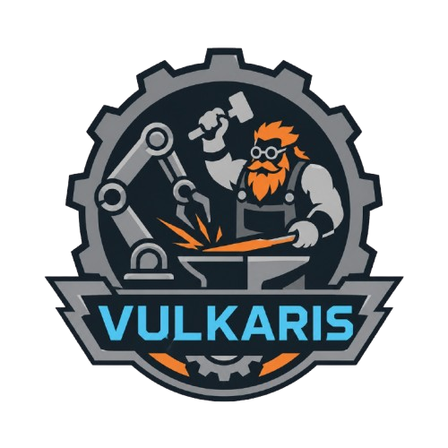
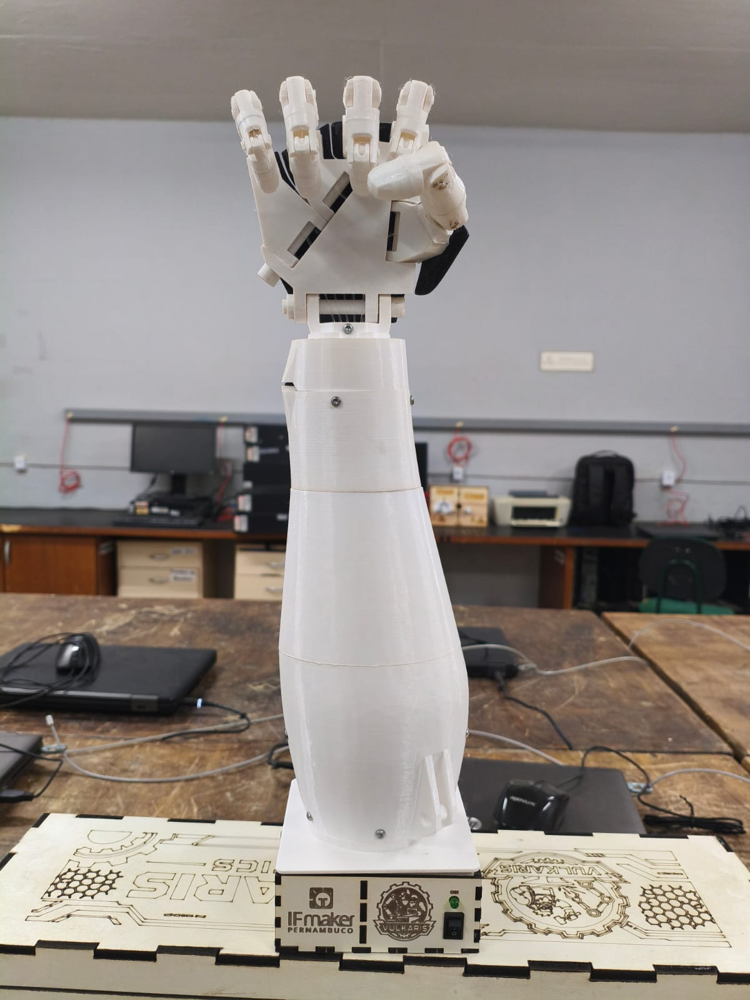
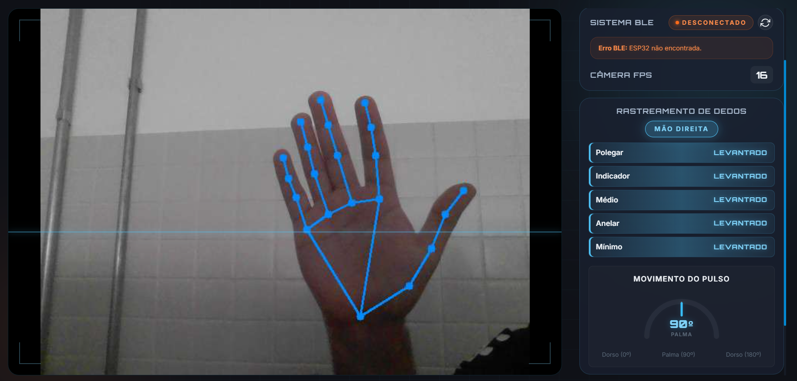
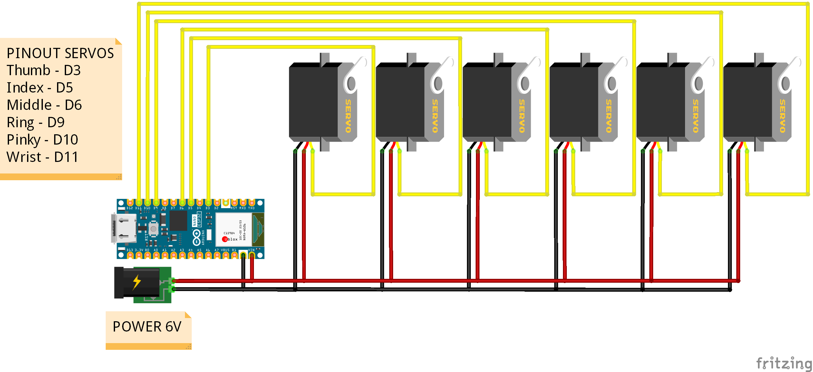

# InMoov Hub: Controle de Braço Robótico com Visão Computacional

<p align="center">
  
</p>

<p align="center">
  <strong>Rastreamento visual da mão e controle de uma mão robótica InMoov em tempo real</strong>
</p>

<p align="center">
  
  
  
  
  
</p>

---

## 📖 Sobre o Projeto

O **InMoov Hub** usa uma webcam para rastrear os dedos e o pulso de uma mão humana e enviar os comandos para uma mão robótica baseada no projeto aberto InMoov. O backend processa as imagens e se comunica com a **ESP32** por **Bluetooth Low Energy (BLE)**.

Recentemente, o projeto evoluiu de um simples script para uma arquitetura moderna dividida entre um **Frontend em React** (Painel de Controle) e um **Backend em FastAPI**.

---

## 🌟 Principais Recursos

- 🖐️ **Rastreamento de Mãos e Pulso:** Desenho em tempo real das conexões na mão e rastreamento do movimento do pulso. Agora suporta tanto a **palma** quanto o **dorso da mão**, evitando perdas de tracking se a mão for virada!
- ⚡ **Comunicação WebSockets:** Transmissão de vídeo e biometria em alta velocidade (~30 FPS) entre o servidor Python e o dashboard web.
- 🎨 **Painel "Glassmorphism":** Interface super moderna feita em React com efeitos translúcidos e design futurista inspirado em Sci-Fi.
- 🛜 **Controle BLE Sem Fio:** Envio instantâneo dos comandos motores do PC direto para a placa ESP32.
- 🔁 **Gravação e Repetição:** Grave sequências nomeadas em arquivos `.txt`, escolha um comando salvo na biblioteca e alterne entre o controle **Ao vivo** e o modo **Gravado**, que repete a sequência em loop.
- 🎥 **Seleção de câmera:** Escolha a câmera usada pelo rastreamento no painel.

---

## 🔁 Gravar e repetir movimentos

No card **Controle de Movimento** do painel:

1. Clique em **Gravar movimento** e faça a sequência com a mão.
2. Clique em **Parar gravação** para salvar a sequência em `movimentos/<nome>.txt`.
3. Escolha uma sequência no dropdown **Comando salvo** para carregar outro movimento.
4. Use **Renomear** ou **Excluir** para administrar o comando selecionado.
5. Use **Repetir movimento** ou selecione **Gravado** para executar o comando em loop.
6. Selecione **Ao vivo** para devolver o controle imediatamente à câmera.

### Formato dos arquivos de movimento

Os arquivos são criados automaticamente na pasta `movimentos/`. O nome informado no painel é usado como identificação do comando e também fica registrado no arquivo. Cada pose contém o instante relativo da gravação e o comando enviado à mão robótica:

```text
# InMoov Hub motion recording
name=Saudação
duration=2.500
# seconds|command
0.000|$00000,090
0.840|$11100,090
1.760|$11111,045
```

O comando segue o formato `$XXXXX,AAA`: cinco bits representam os dedos e `AAA` representa o ângulo do pulso entre `000` e `180` graus. A duração e os intervalos são preservados para que o replay mantenha o ritmo original. Nomes que geram o mesmo arquivo são recusados para evitar sobrescrever comandos existentes.

---

## 🏗️ Arquitetura do Sistema

### 1. Frontend (React + Vite)
- Dashboard para acompanhar o vídeo e os dados do rastreamento.
- Mostra qual mão (`MÃO DIREITA` ou `MÃO ESQUERDA`) foi detectada pelo sistema.
- Exibe o status da conexão BLE, o FPS da câmera, os dados rastreados e o comando enviado à mão (`$XXXXX,AAA`).
- Permite selecionar a câmera, redefinir a posição e conectar ou desconectar o BLE.

### 2. Backend (FastAPI + OpenCV + Bleak)
- Roda no arquivo `app.py`.
- **OpenCV / CVZone / MediaPipe:** Captura os quadros da câmera e analisa os *landmarks* para identificar os dedos e estimar o ângulo do pulso, incluindo palma e dorso da mão.
- **Bleak:** Biblioteca Python que varre o ambiente em busca da ESP32 chamada `InMoov_Hand` e estabelece a conexão remota.
- **Biblioteca de movimentos:** Lê e grava as sequências nomeadas em `movimentos/*.txt`, carregando a sequência selecionada para o modo de repetição.

### 3. Hardware (ESP32 + servomotores)
- Firmware em [`Firmware/inmoov_hand.ino`](Firmware/inmoov_hand.ino), que anuncia o dispositivo BLE `InMoov_Hand`.
- A ESP32 interpreta os cinco bits dos dedos e o ângulo do pulso e controla seis servomotores: um para cada dedo e um para o pulso.

---

## 🔌 API da biblioteca de movimentos

O backend expõe as seguintes rotas para a biblioteca e para o controle de reprodução:

| Método | Rota | Função |
| --- | --- | --- |
| `GET` | `/api/motions` | Lista os arquivos `.txt` válidos em `movimentos/`. |
| `POST` | `/api/motion/record/start` | Inicia uma gravação. Corpo: `{ "name": "Nome do comando" }`. |
| `POST` | `/api/motion/record/stop` | Finaliza e salva a gravação com o nome informado. |
| `POST` | `/api/motion/select` | Carrega um comando. Corpo: `{ "motion_id": "nome_do_arquivo" }`. |
| `PUT` | `/api/motion/{motion_id}` | Atualiza o nome de um comando. Corpo: `{ "name": "Novo nome" }`. |
| `DELETE` | `/api/motion/{motion_id}` | Exclui o arquivo do comando selecionado. |
| `POST` | `/api/motion/mode` | Alterna o controle. Corpo: `{ "mode": "realtime" }` ou `{ "mode": "recorded" }`. |
| `POST` | `/api/motion/playback/start` | Inicia a repetição do comando carregado. |
| `POST` | `/api/motion/playback/stop` | Para a repetição e retorna ao modo em tempo real. |
| `GET` | `/api/motion/status` | Retorna o estado da gravação, seleção e reprodução. |

O WebSocket `/ws` também informa `motion_mode`, `recording`, `selected_motion_name`, `recorded_count`, `recorded_duration` e `tx_command` para manter o painel sincronizado.

---

## 📸 Fotos do Sistema

As imagens do protótipo e do painel de controle ficam na pasta [`fotos/`](fotos/).

### Protótipo robótico

<p align="center">
  
</p>

### Painel e rastreamento da mão

<p align="center">
  
</p>

---

## 📂 Estrutura de Pastas

O repositório está organizado da seguinte forma:

- 📂 arquivos_2d: Contém os arquivos vetoriais em 2D (ex: o desenho `box_inmoov.dxf` para corte a laser da caixa dos componentes).
- 📂 arquivos_3d: Contém todos os arquivos STL para a impressão 3D das peças da mão robótica (como dedos, punho e suportes), do projeto de hardware aberto [InMoov](https://inmoov.fr).
- 📂 Firmware: Firmware C++ para a ESP32 e comunicação BLE (`inmoov_hand.ino`).
- 📂 esquematico: Contém o esquema elétrico de ligação (`Inmoov_esquematico.png`) para montagem do circuito eletrônico do projeto.
- 📂 fotos: Fotos do protótipo robótico e do painel em funcionamento.
- 📂 frontend: Código fonte da interface web (dashboard) desenvolvida em React + Vite.
- 📂 movimentos: Arquivos `.txt` com as sequências gravadas; a pasta é criada automaticamente pelo backend quando consulta a biblioteca.
- 📄 app.py: Arquivo principal do backend em FastAPI que realiza a captura da câmera, processamento de visão computacional e envio de dados da mão.


---

## 🔌 Esquemático e Lista de Materiais

### Esquemático de Ligação


### Lista de Materiais
- Arduino Nano ESP32
- Fio de Nylon 0.8mm
- 6 Servo Motores JX PDI 6221MG (ou similar)
- Fonte 6V 3A (ou maior)
- Interruptor
- LED 5mm
- Resistor 1K ohm
- Jumpers
- Peças Corte a Laser
- Peças Impressas 3D

---

## 🚀 Como Executar

### Pré-requisitos
- Python 3.10+
- Node.js e NPM
- Uma webcam conectada
- ESP32 ligada e executando o código `.ino`

### Upload do Código para a ESP32
1. Abra o arquivo [`Firmware/inmoov_hand.ino`](Firmware/inmoov_hand.ino) na Arduino IDE.
2. Conecte a placa ESP32 ao seu computador via cabo USB.
3. Na Arduino IDE, selecione a placa correspondente (ex: Arduino Nano ESP32) e a porta correta.
4. Clique em "Carregar" (Upload) para gravar o código no microcontrolador.
5. Após o carregamento, a ESP32 estará pronta para receber a conexão via Bluetooth.

### Backend (Processamento e IA)
```bash
# Ative seu ambiente virtual (se aplicável)
# .venv\Scripts\activate

# Instale os requerimentos
pip install -r requirements.txt

# Inicie o servidor FastAPI (a câmera será aberta)
python app.py
```

### Frontend (Dashboard UI)
```bash
cd frontend
npm install
npm run dev
```
Abra o navegador no endereço local fornecido (geralmente `http://localhost:5173`) para visualizar o Painel Hub.

---

## 🛠️ Tecnologias e Ferramentas

 <div style="display: inline-block; margin-top: 10px;">
    &nbsp;
    &nbsp;
    &nbsp;
    &nbsp;
    &nbsp;
 </div>

---

## 🙌 Créditos

O projeto utiliza como referência o projeto aberto de robótica InMoov. Créditos pelo projeto original e mais informações: [inmoov.fr](https://inmoov.fr).

---

## 📝 Licença

Este projeto está licenciado sob a licença MIT - veja o arquivo [LICENSE](LICENSE) para mais detalhes.
